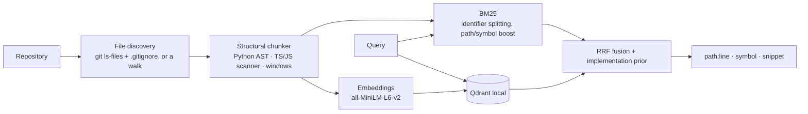

# Hybrid Semantic Code Search

Ask a codebase questions in plain English, for example *"where are JWT tokens verified?"* or *"count people crossing a line in each direction"*, and get the exact function back as `path:line`.

Code is split along its real structure (functions, classes, methods). Each chunk is indexed twice:
- **BM25** over identifier-aware tokens (`verifyJWTToken` → `verify jwt token`)
- **dense embeddings** in a local **Qdrant** collection

The two rankings are fused with Reciprocal Rank Fusion. An honest benchmark shows when fusion helps and when it doesn't.

## Results

The benchmark has natural-language questions about 8 real repositories (907 chunks across Python, TypeScript and JavaScript, plus their Markdown and YAML). Each question has a known answer (file + symbol). The questions are worded the way a developer would ask, deliberately avoiding the identifiers in the code.

| Set | Mode | Recall@1 | Recall@5 | MRR@10 |
|---|---|---|---|---|
| Dev (34 questions) | BM25 only | 0.529 | 0.882 | 0.690 |
| | Dense only | 0.529 | 0.853 | 0.669 |
| | **Hybrid** | **0.676** | **0.941** | **0.775** |
| Held-out (16 questions) | BM25 only | 0.625 | 0.938 | 0.738 |
| | Dense only | **0.750** | **1.000** | **0.856** |
| | Hybrid | **0.750** | **1.000** | 0.846 |

How to read this:

- **Fusion helps most when either method alone is unreliable.** On the dev set, hybrid improves Recall@1 by about 15 points over either method alone.
- **On the held-out set, dense-only ties hybrid on recall and is marginally better on MRR.** The embedding model is strong on these phrasings. Hybrid is still the safer default, because it never fell below the better of the two.
- **The held-out set was written before any tuning**, to check that the improvements below weren't overfitted to the dev set. Hybrid on held-out went from R@1 0.562 / R@5 0.938 to **0.750 / 1.000** after the changes.

Changes driven by error analysis on the dev set:

1. **TS/JS class methods** (`FlagService.updateConfig`) weren't split into chunks, because they have no `function` keyword. Long classes were truncated.
2. **Top-level JS/TS code** outside declarations, such as an exported SQL template string, was never indexed.
3. **Dataclass fields** were split from their class.
4. **Tests, docs and CI config took 48 of the 170 top-5 slots.** A mild "implementation first" prior (×0.85) now applies unless the query mentions tests or docs, and it can be switched off with `--include-tests-docs`.

Reproduce it with `codesearch eval --repo name=path ... --queries eval/queries.json` (the full list of repos is in the query file paths).

## How it works



| Part | Details |
|---|---|
| Chunking | **Python**: `ast` gives functions, async functions, classes (header, docstring and fields) and methods as `Class.method`; remaining module code is grouped. **TS/JS**: a declaration scanner with a brace matcher that ignores braces inside strings, template literals and comments; class methods become their own chunks, as do routes like `router.post('/upload')`. **Other files**: 40-line windows with 10 lines of overlap. Syntax errors fall back to windows |
| Lexical | BM25 (k1 1.2, b 0.75) over identifier-split, lightly stemmed tokens. The path and symbol count ×3 and docstrings ×2, because the name of the code is usually the strongest signal |
| Dense | `sentence-transformers/all-MiniLM-L6-v2` (CPU, normalised) embeds `kind symbol in path` + docstring + code. Vectors live in Qdrant local mode, in memory or on disk with `--storage`; no server needed |
| Fusion | Reciprocal Rank Fusion (k = 60) over the top 50 from each method; filters for language and path glob |
| Incremental | Chunk IDs are content hashes, so re-indexing only embeds changed chunks and deletes stale vectors |

## Usage

```bash
pip install torch --index-url https://download.pytorch.org/whl/cpu
pip install -e ".[dev]"

codesearch search ./my-repo "where are jwt tokens verified"
codesearch search api=../api web=../web "retry failed http requests" --lang typescript
codesearch search ./my-repo "rate limiter" --mode lexical          # no model download needed

CODESEARCH_REPOS="api=../api,web=../web" uvicorn codesearch.api:app   # web UI at http://localhost:8000
```

`GET /search?q=…&k=10&mode=hybrid|dense|lexical&lang=python&path=api/*` returns results with `path`, `start_line`, `end_line`, `symbol`, `kind`, `text`, and the BM25 and dense ranks. `GET /stats` returns the index statistics.

Set `CODESEARCH_MODEL` to try a code-specific embedding model.

## Tests

```bash
pytest -q
```

13 offline tests use a deterministic hashing embedder, so no model is downloaded. They cover:
- the Python and TS/JS chunkers: methods, dataclass fields, top-level template strings, braces inside strings and comments, one-line bodies, syntax-error fallback
- identifier splitting and BM25 ranking
- hybrid search with the implementation prior and the language/path filters
- incremental re-indexing (only changed chunks are re-embedded)
- a lexical-only index
- `.gitignore` handling, including folders nested inside an unrelated parent repository
- the metric arithmetic and the API

## Limitations

- **Small benchmark:** 50 questions over 8 repositories. Treat the numbers as directional.
- **Coarse chunks:** very long functions are truncated at 120 lines.
- **General-purpose embedding model:** a code-specific one (e.g. Jina code embeddings) may do better; swap it via `CODESEARCH_MODEL`.
- **No call-graph awareness yet.**

## License

MIT
